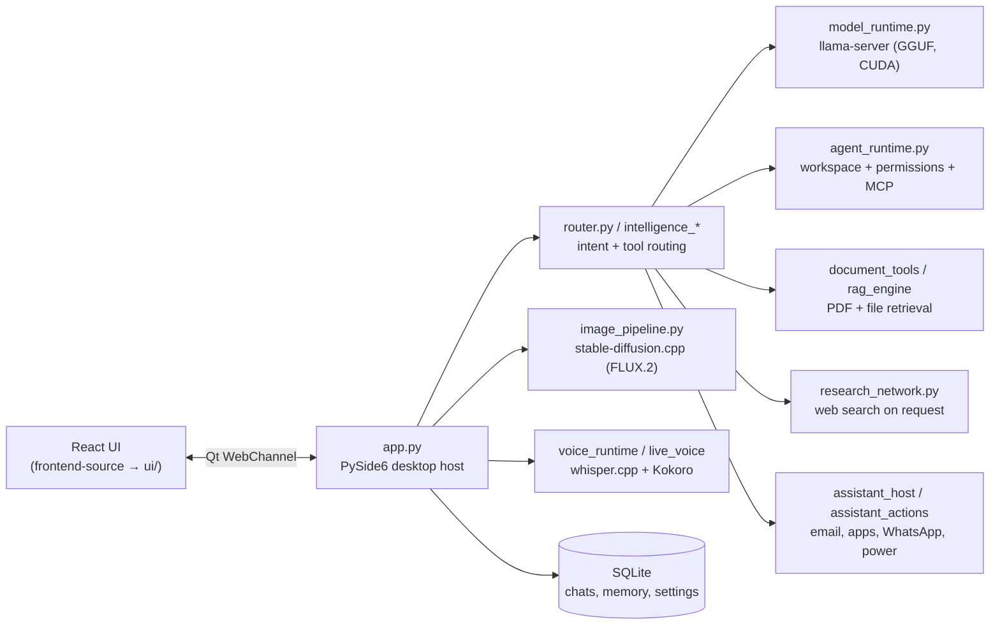

# Offline Studio

**A private AI assistant for Windows that runs entirely on your own PC.** Chat, voice, vision, image generation and an
email assistant, with no cloud account, subscription or data leaving the machine (web search runs only when you ask).

> Formerly *OfflineGPT*. The repository name is kept for existing links.

---

## Features

| Area | What it does |
|---|---|
| **Chat** | Streaming answers from local GGUF models (GPT-OSS 20B, Qwen 3 / 3.5), conversation history, projects, file attachments |
| **Documents** | Reads PDFs, Word and text files; answers with page-level citations |
| **Web on request** | Searches the web only when you ask, and cites the pages it used |
| **Agent mode** | Carries out multi-step tasks in a workspace folder you choose, with a permission prompt for each risky step |
| **Vision** | Describe, read or answer questions about images (Qwen3-VL) |
| **Image Studio** | Text-to-image and image editing with FLUX.2 Klein, plus 4x upscaling |
| **Voice** | Speech-to-text with Whisper Large v3 Turbo on the GPU; spoken replies with Kokoro |
| **Assistant actions** | "Email my father at 7:30 tomorrow saying …": drafts, schedules and sends it by itself. It can also open apps, send WhatsApp messages, and shut down or restart the PC (it asks first) |
| **Interface** | AMOLED-black desktop UI, a command palette, a Tasks tab and small toasts for finished background jobs |

## Requirements

- Windows 10 or 11, 64-bit
- **NVIDIA GPU with 8 GB+ VRAM recommended** (tested on an RTX 4060 Laptop, 8 GB). An up-to-date NVIDIA driver is
  needed; the CUDA 12 runtime is included, so there is nothing else to install. CPU-only works, but it is slow.
- 16 GB RAM (32 GB for GPT-OSS 20B)
- Disk: about 3.5 GB for the app, plus your models (5–25 GB depending on which you choose)

## Install

1. Download **`OfflineStudio-<version>-win64.zip`** from the [latest release](https://github.com/saket3106/OfflineGPT/releases/latest).
2. Right-click it, choose **Extract All…**, and extract it somewhere with space, e.g. `D:\OfflineStudio`.
   You will get:
   ```
   OfflineStudio\
   ├── Application\          the app (open "Offline Studio.exe")
   └── Models\               put model files here
       ├── Chat\  Vision\  Image\  Whisper\
   ```
3. Download the models you want (below) into the matching `Models` folder.
4. Open `Application\Offline Studio.exe`. If Windows SmartScreen appears, choose **More info → Run anyway**: the app
   is not code-signed.

Your chats, settings and generated images are stored inside `Application\`. Back that folder up before deleting it.

## Models

The app finds models **by file name**, so keep the names shown here. You only need the chat model to start; add the others for
the features you want.

| Folder | File | Size | Used for |
|---|---|---|---|
| `Models\Chat` | `Qwen3.5-9B-Q4_K_M.gguf` *(recommended for 8 GB GPUs)* | 5.3 GB | Chat |
| `Models\Chat` | `gpt-oss-20b-MXFP4.gguf` *(strongest, needs 32 GB RAM)* | 12 GB | Chat |
| `Models\Chat` | `Qwen3-4B-Q4_K_M.gguf` *(fast, light)* | 2.4 GB | Chat |
| `Models\Vision` | `Qwen3VL-8B-Instruct-Q4_K_M.gguf` + `mmproj-Qwen3VL-8B-Instruct-F16.gguf` | 4.7 + 1.1 GB | Understanding images |
| `Models\Image` | `flux-2-klein-base-9b-Q4_K_M.gguf` | 5.6 GB | Image generation |
| `Models\Image` | `Qwen3-8B-Q4_K_S.gguf` | 4.5 GB | Text encoder for FLUX.2 |
| `Models\Image` | `flux2-vae.safetensors` | 321 MB | FLUX.2 VAE |
| `Models\Image` | `4x-UltraSharp.pth` | 64 MB | Upscaling |
| `Models\Whisper` | `ggml-large-v3-turbo-q5_0.bin` | 548 MB | Voice input |

Where to get them: search the file name on [Hugging Face](https://huggingface.co/models). The Whisper model is in
[ggerganov/whisper.cpp](https://huggingface.co/ggerganov/whisper.cpp/tree/main) and Qwen3-VL in
[Qwen/Qwen3-VL-8B-Instruct-GGUF](https://huggingface.co/Qwen/Qwen3-VL-8B-Instruct-GGUF). Any other GGUF chat
model can be added from **Settings → Models**. Check each model's license before you use it.

## How it works



- **Desktop host**: `app.py` creates the Qt window, serves the built React UI and exposes a WebChannel bridge (`assistantPlan`,
  `assistantExecute`, `saveAssistantSettings`, …) that the UI calls.
- **Native engines**: these run as local child processes. `llama-server.exe` (llama.cpp) handles chat and vision,
  `whisper-server.exe` handles speech and `sd-cli.exe` handles images. CUDA libraries sit in the `Application` root,
  which is added to their `PATH`.
- **Model lookup**: `integrated_runtime.py` resolves each configured model by file name in `..\Models\<Chat|Vision|Image|Whisper>`.
- **Email assistant**: SMTP with automatic server discovery (MX lookup) and an app password stored with Windows DPAPI.
  Emails with a time are scheduled and sent by a background outbox, even after a restart.

More detail is in [`docs/`](docs/): `AGENT_MODE.md`, `MODEL_RUNTIME.md`, `MODEL_MANAGER.md` and `RUNTIME_COMPATIBILITY.md`.

## Repository layout

```
app.py                     desktop host + UI bridge
integrated_runtime.py      configuration, model paths, engine processes
router.py, intelligence_*  intent routing and tool selection
agent_*.py                 Agent mode (workspace, permissions, MCP, memory)
assistant_*.py             email, app launching and other assistant actions
image_pipeline.py          Image Studio
voice_*.py, live_voice.py  speech in/out
frontend-source/           React + Vite UI source (builds into ui/)
tests/                     Python unit tests        qa/   in-app test scripts
tools/release_inplace.py   build + install a new release
docs/                      design notes
```

## Developing

Requires Python 3.12, Node 20+ and pnpm.

```powershell
python -m venv .venv
.\.venv\Scripts\python -m pip install -r requirements.txt -r requirements-agent.txt
cd frontend-source; pnpm install --frozen-lockfile; pnpm build; cd ..   # builds ui/
$env:OFFLINE_GPT_DATA_DIR = "$env:LOCALAPPDATA\OfflineStudio-dev"   # keep test data away from real chats
.\.venv\Scripts\python app.py
```

Tests:

```powershell
python -X utf8 -m unittest discover -s tests -p "test_*.py"     # backend
cd frontend-source; npx vitest run; node --test src/*.test.js    # frontend
```

The source checkout does not include the native engines (`llama-server`, whisper, stable-diffusion, CUDA DLLs). For a
complete working app, use the release zip, or copy those engines from it next to `app.py`.

## Publishing an update (maintainer notes)

After a major improvement:

```powershell
cd C:\Users\mesak\Documents\OfflineGPT\Source
git status                                  # review what changed
git add -A
git commit -m "Short description of the improvement"
git push origin HEAD:main                   # update GitHub
git tag v1.1.0; git push origin v1.1.0      # optional: mark a new version
```

To publish a new downloadable package, run `python tools/make_release_zip.py v1.1.0`. It zips the installed `Application`
without your personal data and writes `OfflineStudio-v1.1.0-win64.zip` into the `OfflineGPT` folder. Then on GitHub go to **Releases → Draft a new release**. Choose the tag, attach the zip and click **Publish**. Each attached file must be under 2 GB.

## Privacy

Everything runs locally. Nothing is sent anywhere unless you ask for a web search, send an email or open a link. Chats,
settings, the email password (encrypted with Windows DPAPI) and generated images stay in `Application\` on your PC.

## License and third-party components

Offline Studio bundles llama.cpp, whisper.cpp and stable-diffusion.cpp (MIT), Qt / PySide6 (LGPL v3), Kokoro and the
NVIDIA CUDA runtime (redistributable under NVIDIA's EULA). Models are not included and each has its own license.
